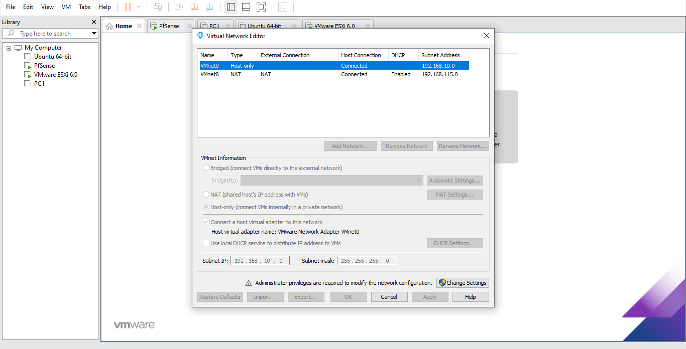
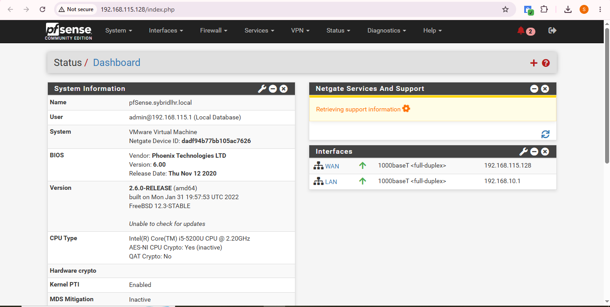

# Day 1: Network check aur GitHub setup

## Maqsad
pfSense VM ke network adapters check karna aur WAN/LAN IP note karna.

## Lab setup
- Host: VMware Workstation Pro
- pfSense adapter 1 (WAN): NAT
- pfSense adapter 2 (LAN): Host-only (VMnet0)

## IP addresses
| Interface | IP |
|-----------|----|
| WAN | 192.168.115.128 |
| LAN | 192.168.10.1 |

## Steps
1. Virtual Network Editor mein VMnet1 ka local DHCP service band kiya.
2. pfSense VM chalayi aur WAN/LAN IP dekhe.
3. pfSense dashboard login karke check kiya.

## Masla aur hal
Koi masla nahi aya.

## Screenshots

### Workstation Virtual Network Editor

### pfSense Dashboard

